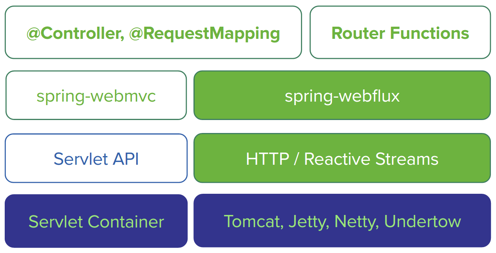

# Create a WebFlux application from Scratch

A working example is worth a thousand words. Let's write code and explore the reactive programming features introduced in Spring Framework 7.

As an example, I will reuse the same concept in my former [Spring Boot sample codes](https://github.com/hantsy/angularjs-springmvc-sample-boot) which is a simple blog application.

> In this post, we prepare the codes manually and do not use Spring Boot autoconfiguration. I think it will help you to understand the essential configuration in a Spring WebFlux application.

In the following steps we will start with creating RESTful APIs for `Post`.

## Prerequisites

Before writing some real codes, make sure you have installed the essential software:

- Java 21. Install a JDK from [Adoptium](https://adoptium.net/), Oracle, or your preferred vendor.
- [Apache Maven](https://maven.apache.org) or [Gradle](https://gradle.org)
- Your favorite IDE:
    - [IntelliJ IDEA](https://www.jetbrains.com/idea/) (Community or Ultimate Edition)
    - [Eclipse IDE](https://eclipseide.org/) — with [Spring Tools](https://spring.io/tools) for Spring support
    - [Apache NetBeans IDE](https://netbeans.apache.org/)
    - [VS Code](https://code.visualstudio.com/) with the Java and Spring Boot extensions

> **NOTE**: Do not forget to add path which includes `java` and `mvn` command into your system environment variable **PATH** .

## Generate project skeleton

Personally I prefer to use Apache Maven to build Java applications.

Run the following command to create a general web application from the existing Maven archetype.

```
$ mvn archetype:generate -DgroupId=com.example \
	-DartifactId=demo \
	-DarchetypeArtifactId=maven-archetype-webapp \
	-DinteractiveMode=false \
```

> **NOTE**: I would like Unix like bash to run commands in my terminal. Under Windows system, you can choose CygWin or convert it to Windows form.

Import the generated codes into your IDE..

Open _pom.xml_ in your IDE editor, add some modifications:

1. Add `spring-boot-starter-parent` as parent POM to manage the versions of all required dependencies for this project.
2. Add `spring-webflux`, `jackson-databind`, `reactor-core` as dependencies to get Spring Web Reactive support
3. Add `logback` as logging framework, `jcl-over-slf4j` is a bridge for Spring jcl and slf4j.
4. Add Lombok to erase the tedious getters, setters, etc for POJO classes. More details go to [Lombok project](https://projectlombok.org).

The final pom.xml looks like:

```xml
<?xml version="1.0" encoding="UTF-8"?>
<project xmlns="http://maven.apache.org/POM/4.0.0" xmlns:xsi="http://www.w3.org/2001/XMLSchema-instance"
         xsi:schemaLocation="http://maven.apache.org/POM/4.0.0 http://maven.apache.org/xsd/maven-4.0.0.xsd">
    <modelVersion>4.0.0</modelVersion>

    <groupId>com.example</groupId>
    <artifactId>spring-reactive-sample-vanilla</artifactId>
    <version>0.0.1-SNAPSHOT</version>
    <packaging>jar</packaging>

    <name>spring-reactive-sample-vanilla</name>
    <description>Spring Webflux demo(without Spring Boot)</description>

    <parent>
        <groupId>org.springframework.boot</groupId>
        <artifactId>spring-boot-starter-parent</artifactId>
        <version>4.0.0</version>
        <relativePath/> <!-- lookup parent from repository -->
    </parent>

    <properties>
        <project.build.sourceEncoding>UTF-8</project.build.sourceEncoding>
        <project.reporting.outputEncoding>UTF-8</project.reporting.outputEncoding>
        <java.version>21</java.version>
    </properties>

    <dependencies>
        <dependency>
            <groupId>org.springframework</groupId>
            <artifactId>spring-context</artifactId>
        </dependency>
        <dependency>
            <groupId>org.springframework</groupId>
            <artifactId>spring-webflux</artifactId>
        </dependency>

        <dependency>
            <groupId>com.fasterxml.jackson.core</groupId>
            <artifactId>jackson-databind</artifactId>
        </dependency>

        <dependency>
            <groupId>io.netty</groupId>
            <artifactId>netty-buffer</artifactId>
        </dependency>

        <dependency>
            <groupId>io.projectreactor.netty</groupId>
            <artifactId>reactor-core</artifactId>
        </dependency>

        <dependency>
            <groupId>org.projectlombok</groupId>
            <artifactId>lombok</artifactId>
        </dependency>

        <dependency>
            <groupId>org.slf4j</groupId>
            <artifactId>slf4j-api</artifactId>
        </dependency>
        <dependency>
            <groupId>org.slf4j</groupId>
            <artifactId>jcl-over-slf4j</artifactId>
        </dependency>
        <dependency>
            <groupId>ch.qos.logback</groupId>
            <artifactId>logback-core</artifactId>
        </dependency>
        <dependency>
            <groupId>ch.qos.logback</groupId>
            <artifactId>logback-classic</artifactId>
        </dependency>

    </dependencies>
</project>
```

## Getting started

The project skeleton is ready, now let's add some codes to play reactive programming.

Create a new class named `Post`, it includes three fields: `id`, `title`, `content`.

```java
@Data
@ToString
@Builder
@NoArgsConstructor
@AllArgsConstructor
class Post {

    private Long id;
    private String title;
    private String content;

}
```

In the above codes, `@Data`, `@ToString`, `@Builder`, `@NoArgsConstructor`, `@AllArgsConstructor` are from the Lombok project.

When you compile `Post`, it will utilize Java compiler built-in _Annotation Processing Tooling_ feature to add extra facilities into the final compiled classes, including:

1. Getters and setters of the three fields, and overrides `equals` and `hashCode` methods.
2. Overrides `toString` method.
3. A builder class for creating the Post instance more easily.
4. A constructor with no arguments.
5. A constructor with all fields as arguments.

Create a dummy repository named `PostRepository` to retrieve posts from and save them back to a repository.

```java
@Component
class PostRepository {

    private static final Map<Long, Post> DATA = new HashMap<>();
    private static long ID_COUNTER = 1L;

    static {
        Arrays.asList("First Post", "Second Post")
            .stream()
            .forEach((java.lang.String title) -> {
                long id = ID_COUNTER++;
                DATA.put(Long.valueOf(id), Post.builder().id(id).title(title).content("content of " + title).build());
            }
            );
    }

    Flux<Post> findAll() {
        return Flux.fromIterable(DATA.values());
    }

    Mono<Post> findById(Long id) {
        return Mono.just(DATA.get(id));
    }

    Mono<Post> createPost(Post post) {
        long id = ID_COUNTER++;
        post.setId(id);
        DATA.put(id, post);
        return Mono.just(post);
    }

}
```

Currently we have not connected to any database, so this repository uses a `Map` backed data store instead. When we discuss the reactive features provided by the Spring Data projects, we will replace it with a real Spring Data reactive implementation.

If you have used Spring Data before, you will find these APIs are every similar with `Repository` interface provided in Spring Data.

The main difference is in the current Repository class all methods return a `Flux` or `Mono`.

`Flux` and `Mono` are from Reactor, which powers the reactive support in Spring Framework 7 by default.

- `Flux` represents a stream of 0..N elements.
- `Mono` represents an asynchronous 0..1 result.

Create a controller class named `PostController` to expose RESTful APIs for the `Post` entity.

```java
@RestController
@RequestMapping(value = "/posts")
class PostController {

    private final PostRepository posts;

    public PostController(PostRepository posts) {
        this.posts = posts;
    }

    @GetMapping(value = "")
    public Flux<Post> all() {
        return this.posts.findAll();
    }

    @GetMapping(value = "/{id}")
    public Mono<Post> get(@PathVariable(value = "id") Long id) {
        return this.posts.findById(id);
    }

    @PostMapping(value = "")
    public Mono<Post> create(Post post) {
        return this.posts.createPost(post);
    }

}
```

If you have some experience in Spring WebMvc, you will see the above codes are almost same as the existing one, except we return a `Flux` or `Mono` as the response body.

Next, create a `@Configuration` class and add an `@EnableWebFlux` annotation to activate WebFlux support in this application.

```java
@Configuration
@ComponentScan
@EnableWebFlux
class WebConfig {

}
```

The application code is ready. Let's bootstrap the application.

## Bootstrap

According to the official documentation (see the Web on Reactive Stack section), Spring Framework 7 provides several options to bootstrap a reactive web application: https://docs.spring.io/spring-framework/docs/current/reference/html/web-reactive.html#spring-webflux

> Spring WebFlux is supported on Tomcat, Jetty, Servlet 3.1+ containers, as well as on non-Servlet runtimes such as Netty and Undertow.



Every bootstrap variant follows the same three steps, built on a handful of core Spring types (Javadoc links):

1. Build an [`HttpHandler`](https://docs.spring.io/spring-framework/docs/current/javadoc-api/org/springframework/http/server/reactive/HttpHandler.html) from the `ApplicationContext` with [`WebHttpHandlerBuilder`](https://docs.spring.io/spring-framework/docs/current/javadoc-api/org/springframework/web/server/adapter/WebHttpHandlerBuilder.html) — the low-level contract for reactive request handling.
2. Wrap it in a server-specific adapter: [`TomcatHttpHandlerAdapter`](https://docs.spring.io/spring-framework/docs/current/javadoc-api/org/springframework/http/server/reactive/TomcatHttpHandlerAdapter.html), [`JettyCoreHttpHandlerAdapter`](https://docs.spring.io/spring-framework/docs/current/javadoc-api/org/springframework/http/server/reactive/JettyCoreHttpHandlerAdapter.html), [`ReactorHttpHandlerAdapter`](https://docs.spring.io/spring-framework/docs/current/javadoc-api/org/springframework/http/server/reactive/ReactorHttpHandlerAdapter.html), or [`UndertowHttpHandlerAdapter`](https://docs.spring.io/spring-framework/docs/current/javadoc-api/org/springframework/http/server/reactive/UndertowHttpHandlerAdapter.html). Above the adapter, the [`WebHandler`](https://docs.spring.io/spring-framework/docs/current/javadoc-api/org/springframework/web/server/WebHandler.html) chain assembles the filters and exception handlers — see [An introduction to Reactive Web](../web/intro.md).
3. Start the embedded server.

### Apache Tomcat

Create a general-purpose `Application` class to start the application manually.

```java
@Configuration
@ComponentScan
@PropertySource(value = "classpath:application.properties", ignoreResourceNotFound = true)
public class Application {

    @Value("${server.port:8080}")
    private int port = 8080;

    public static void main(String[] args) throws Exception {
        ApplicationContext context = new AnnotationConfigApplicationContext(Application.class);  // (1)

        Tomcat tomcatServer = context.getBean(Tomcat.class);
        tomcatServer.start();

        System.out.println("Tomcat server is running at port:"
                           + tomcatServer.getConnector().getLocalPort());
    	//System.in.read();
    }

    @Bean
    @Profile("default")
    public Tomcat embeddedTomcatServer(ApplicationContext context) {
        HttpHandler handler = WebHttpHandlerBuilder.applicationContext(context).build();

        Servlet servlet = new TomcatHttpHandlerAdapter(handler);
        Tomcat tomcat = new Tomcat();

        File base = new File(System.getProperty("java.io.tmpdir"));
        Context rootContext = tomcat.addContext("", base.getAbsolutePath());
        Tomcat.addServlet(rootContext, "main", servlet).setAsyncSupported(true);
        rootContext.addServletMappingDecoded("/", "main");

        tomcat.setHostname("localhost");
        tomcat.setPort(this.port);
        tomcat.setBaseDir(System.getProperty("java.io.tmpdir"));

        return tomcat;
    }

}
```

The above codes perform some tasks.

1. Create a `HttpHandler` from `ApplicationContext`.
2. Use `TomcatHttpHandlerAdapter` to bridge the Servlet APIs to the reactive based `HttpHandler`.
3. Start tomcat server.

Do not forget add the `tomcat-embed-core` to project dependencies.

```xml
 <dependency>
	<groupId>org.apache.tomcat.embed</groupId>
	<artifactId>tomcat-embed-core</artifactId>
</dependency>
```

You can simply run this class in IDEs as java applications.

If you want to package all dependencies into one jar and run the application in command line, eg. `java -jar filename`, `maven-assembly-plugin` can help this purpose.

Add `maven-assembly-plugin` configuration into the pom.xml file.

```xml
<!-- Maven Assembly Plugin -->
<plugin>
	<groupId>org.apache.maven.plugins</groupId>
	<artifactId>maven-assembly-plugin</artifactId>
	<configuration>
		<descriptorRefs>
			<descriptorRef>jar-with-dependencies</descriptorRef>
		</descriptorRefs>
		<!-- MainClass in mainfest make a executable jar -->
		<archive>
			<manifest>
				<mainClass>com.example.demo.Application</mainClass>
			</manifest>
		</archive>

	</configuration>
	<executions>
		<execution>
			<id>make-assembly</id>
			<phase>package</phase> <!-- bind to the packaging phase -->
			<goals>
				<goal>single</goal>
			</goals>
		</execution>
	</executions>
</plugin>
```

Open your terminal, run the following command in your project root folder:

```
mvn package
```

When it is done, switch to the _target_ folder, besides the general jar, you will find an extra fat jar was generated, which filename is ended with **jar-with-dependencies.jar**.

```
spring-reactive-sample-vanilla-0.0.1-SNAPSHOT-jar-with-dependencies.jar
spring-reactive-sample-vanilla-0.0.1-SNAPSHOT.jar
```

Run the following command to run this application.

```
java -jar target/spring-reactive-sample-vanilla-0.0.1-SNAPSHOT-jar-with-dependencies.jar
```

When it is started, let's try to verify if it works.

```
#curl http://localhost:8080/posts
[{"id":1,"title":"First Post","content":"content of First Post"},{"id":2,"title":"Second Post","content":"content of Second Post"}]
```

For the complete codes, check [spring-reactive-sample/vanilla-tomcat](https://github.com/hantsy/spring-reactive-sample/tree/master/vanilla-tomcat).

### Eclipse Jetty

To use a Jetty server instead, replace the `Application` class with the following:

```java
@Configuration
@ComponentScan
@PropertySource(value = "classpath:application.properties", ignoreResourceNotFound = true)
public class Application {

    @Value("${server.port:8080}")
    private int port = 8080;

    public static void main(String[] args) throws Exception {
        ApplicationContext context = new AnnotationConfigApplicationContext(Application.class);
        Server server = context.getBean(Server.class);

        // 4. Starts up application
        server.start();

        System.out.println("Press ENTER to exit.");
        System.in.read();
    }

    @Bean
    public Server jettyServer(ApplicationContext context) throws Exception {
        // 1. Initialize the adapter with Spring's HttpHandler
        HttpHandler httpHandler = WebHttpHandlerBuilder.applicationContext(context).build();
        // 2. Create the Jetty Core adapter
        JettyCoreHttpHandlerAdapter adapter = new JettyCoreHttpHandlerAdapter(httpHandler);

        // 3. Set up the Jetty 12 Core Path Mappings
        PathMappingsHandler pathMappingsHandler = new PathMappingsHandler();

        // CRITICAL JETTY 12 CHANGE: Bind your adapter explicitly via PathSpec
        // Use "/*" to ensure all sub-paths underneath the root context are matched correctly
        pathMappingsHandler.addMapping(PathSpec.from("/*"), adapter);

        // 4. Initialize server and attach the mapping handler
        Server server = new Server();
        server.setHandler(pathMappingsHandler);

        // 5. Setup Network Connector
        ServerConnector connector = new ServerConnector(server);
        connector.setPort(port);
        server.addConnector(connector);

        return server;
    }

}
```

Since Jetty 11, the Jetty artifact IDs changed: the servlet support moved into environment-specific modules such as `jetty-ee11-servlet` (Jetty 12, EE 11 environment), and the servlet-era `ServletContextHandler` bootstrap is replaced by Jetty Core's `PathMappingsHandler`. Declare a BOM for the EE 11 environment and use the new coordinates:

```xml
<dependencyManagement>
    <dependencies>
        <dependency>
            <groupId>org.eclipse.jetty.ee11</groupId>
            <artifactId>jetty-ee11-bom</artifactId>
            <version>${jetty.version}</version>
            <type>pom</type>
            <scope>import</scope>
        </dependency>
    </dependencies>
</dependencyManagement>

<dependencies>
    <dependency>
        <groupId>org.eclipse.jetty</groupId>
        <artifactId>jetty-server</artifactId>
    </dependency>
    <dependency>
        <groupId>org.eclipse.jetty.ee11</groupId>
        <artifactId>jetty-ee11-servlet</artifactId>
    </dependency>
</dependencies>
```

Similarly, you can run the application directly in your IDEs.

For the complete codes, check [spring-reactive-sample/vanilla-jetty](https://github.com/hantsy/spring-reactive-sample/tree/master/vanilla-jetty).

Alternatively, you can run the application in Reactor Netty, or JBoss Undertow.

### Reactor Netty

For Reactor Netty, replace the `Application` class with:

```java
@Configuration
@ComponentScan
@PropertySource(value = "classpath:application.properties", ignoreResourceNotFound = true)
public class Application {

    @Value("${server.port:8080}")
    private int port = 8080;

    public static void main(String[] args) throws Exception {
        try (AnnotationConfigApplicationContext context = new AnnotationConfigApplicationContext(
                Application.class)) {
            context.getBean(HttpServer.class)
                    .bindUntilJavaShutdown(Duration.ofSeconds(60), null);
        }
    }

    @Bean
    public HttpServer httpServer(ApplicationContext context) {
        HttpHandler handler = WebHttpHandlerBuilder.applicationContext(context).build();
        ReactorHttpHandlerAdapter adapter = new ReactorHttpHandlerAdapter(handler);
        return  HttpServer.create()
                .host("localhost")
                .port(this.port)
                .handle(adapter);
    }

}
```

And add `reactor-netty` in your project dependencies.

```xml
<dependency>
	<groupId>io.projectreactor.netty</groupId>
	<artifactId>reactor-netty</artifactId>
</dependency>
```

For the complete codes, check [spring-reactive-sample/vanilla](https://github.com/hantsy/spring-reactive-sample/tree/master/vanilla).

### Undertow (deprecated)

For Undertow, replace the `Application` class with:

```java
@Configuration
@ComponentScan
@PropertySource(value = "classpath:application.properties", ignoreResourceNotFound = true)
public class Application {

    @Value("${server.port:8080}")
    private int port = 8080;

    public static void main(String[] args) throws Exception {
        ApplicationContext context = new AnnotationConfigApplicationContext(Application.class);  // (1)
        Undertow server = context.getBean(Undertow.class);
        server.start();
        System.out.println("Press ENTER to exit.");
        System.in.read();
    }

    @Bean
    public Undertow undertowServer(ApplicationContext context) {
        HttpHandler handler = WebHttpHandlerBuilder.applicationContext(context).build();  // (2)

        // Undertow
        UndertowHttpHandlerAdapter undertowAdapter = new UndertowHttpHandlerAdapter(handler);
        Undertow server = Undertow.builder()
            .addHttpListener(port, "localhost")
            .setHandler(undertowAdapter)
            .build();

        return server;
    }

}
```

And add `undertow-core` in your project dependencies.

```xml
<dependency>
	<groupId>io.undertow</groupId>
	<artifactId>undertow-core</artifactId>
</dependency>
```

### Standalone Servlet Container

If you prefer traditional web applications and want to package a WAR to deploy into a servlet container, Spring Framework 7 provides `AbstractReactiveWebInitializer` to help initialize a reactive web application in a Servlet environment. This class implements `WebApplicationInitializer` and is discovered by the servlet container at startup.

Create a `AppInitializer` instead of the `Application` class.

```java
public class AppInitializer extends AbstractReactiveWebInitializer {

    @Override
    protected Class<?>[] getConfigClasses() {
        return new Class[]{
                AppConfig.class,
                WebConfig.class
        };
    }
}
```

> The former `AbstractAnnotationConfigDispatcherHandlerInitializer` is problematic, check notes I added in the sample codes [spring-reactive-sample/war](https://github.com/hantsy/spring-reactive-sample/blob/master/war/src/main/java/com/example/demo/AppInitializer.java)

Next change the project packaging from **jar** to **war** in pom.xml.

```xml
<packaging>war</packaging>
```

And add the Jakarta Servlet API to your project dependencies.

```xml
<dependency>
	<groupId>jakarta.servlet</groupId>
	<artifactId>jakarta.servlet-api</artifactId>
	<scope>provided</scope>
</dependency>
```

Now you can run this application on an IDE managed Servlet container directly.

Or package the project into a **war** format and deploy it into a Servlet based container (Tomcat, Jetty) manually.

Alternatively, if you want to run this application via `mvn` commands in the development stage, the [Jetty EE 11 Maven plugin](https://eclipse.dev/jetty/documentation/jetty-12/programming-guide/index.html#jetty-maven-plugin) serves the WAR in place:

```xml
<plugin>
	<groupId>org.eclipse.jetty.ee11</groupId>
	<artifactId>jetty-ee11-maven-plugin</artifactId>
	<configuration>
		<scanIntervalSeconds>10</scanIntervalSeconds>
		<webApp>
			<contextPath>/</contextPath>
		</webApp>
	</configuration>
</plugin>
```

Run the following command to start it.

```
mvn jetty:run
```

Or use the Cargo plugin to package and deploy into an embedded Tomcat controlled by **cargo**:

```xml
<plugin>
	<groupId>org.apache.maven.plugins</groupId>
	<artifactId>maven-war-plugin</artifactId>
	<configuration>
		<failOnMissingWebXml>false</failOnMissingWebXml>
	</configuration>
</plugin>
<plugin>
	<groupId>org.codehaus.cargo</groupId>
	<artifactId>cargo-maven3-plugin</artifactId>
	<configuration>
		<container>
			<containerId>tomcat10x</containerId>
			<type>embedded</type>
		</container>

		<configuration>
			<properties>
				<cargo.servlet.port>8080</cargo.servlet.port>
				<cargo.logging>high</cargo.logging>
			</properties>
		</configuration>
	</configuration>
</plugin>
```

```
mvn verify cargo:run
```

Check the sample codes: [spring-reactive-sample/war](https://github.com/hantsy/spring-reactive-sample/tree/master/war).

### Alternative Bean Registration

In the example above we use ApplicationContext component scanning. For classes that are not part of the component scan, Spring Framework 7 provides a concise registerBean API to programmatically register instances as Spring beans in the ApplicationContext.

```java
public class Application {

    public static void main(String[] args) throws Exception {
        AnnotationConfigApplicationContext context = new AnnotationConfigApplicationContext();
        PostRepository posts = new PostRepository();
        PostHandler postHandler = new PostHandler(posts);
        Routes routesBean = new Routes(postHandler);

        context.registerBean(PostRepository.class, () -> posts);
        context.registerBean(PostHandler.class, () -> postHandler);
        context.registerBean(Routes.class, () -> routesBean);
        context.registerBean(WebHandler.class, () -> RouterFunctions.toWebHandler(routesBean.routes(), HandlerStrategies.builder().build()));
        context.refresh();

        nettyServer(context).onDispose().block();
    }

    public static DisposableServer nettyServer(ApplicationContext context) {
        HttpHandler handler = WebHttpHandlerBuilder.applicationContext(context).build();
        ReactorHttpHandlerAdapter adapter = new ReactorHttpHandlerAdapter(handler);
        HttpServer httpServer = HttpServer.create().host("localhost").port(8080);
        return httpServer.handle(adapter).bindNow();
    }

}
```

For the complete codes, check [spring-reactive-sample/register-bean](https://github.com/hantsy/spring-reactive-sample/blob/master/register-bean).
